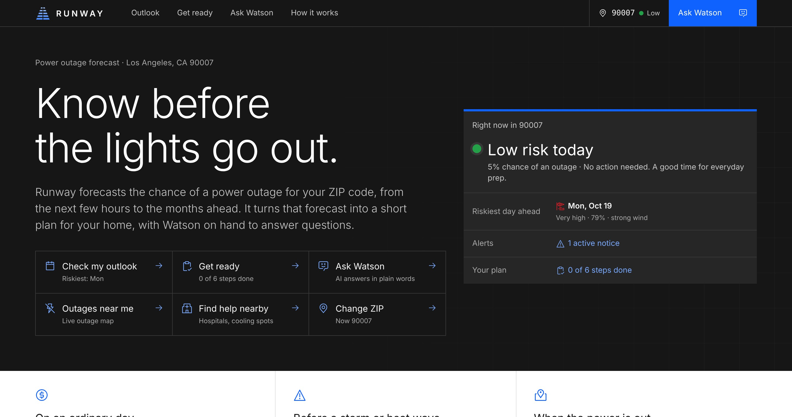
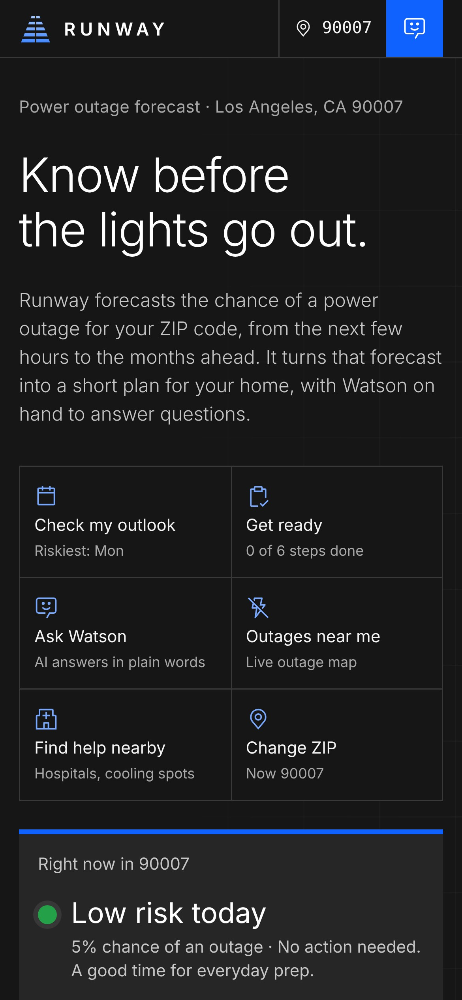
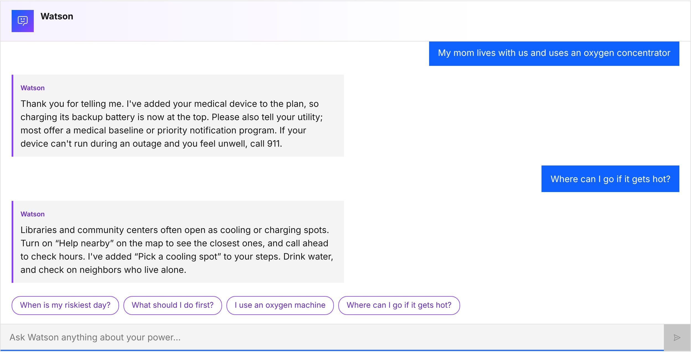

# Runway

**The weather app for power outages.** Runway forecasts outage risk for your ZIP code, learns what your home can't lose (a medical device, fridge medicine, an EV, a tight budget) and builds a plan before the lights go out. Ask Watson, powered by IBM watsonx.ai, and it adds steps to your plan.

Built for the InnovateLA × Dual-Use Hackathon 2026 (Energy & Grid) by Serena, Nitin and Harshika. Built with IBM Bob.



## Try it in 10 seconds

**No installs. No build step. No account.**

1. Download or clone this repo.
2. Double-click **`runway.html`**.

That's it. It opens in any modern browser and works offline with sample weather. With internet, it pulls live forecasts, alerts, outages, fires and map layers.

## Run it with live Watson (optional)

Needs only Python 3.9 or newer, which comes with macOS and most Linux. Nothing to `pip install`.

```sh
python3 server.py
```

Then open **http://localhost:8080**.

Without credentials, Watson still answers from built-in, safety-checked guidance. To use IBM watsonx.ai (Granite):

```sh
cp .env.example .env      # then add your WATSONX_API_KEY and WATSONX_PROJECT_ID
python3 server.py
```

The terminal shows `watsonx: on` when it's connected. Keys stay on the server: they're never sent to the browser, and `.env` is git-ignored.

## What it does

| Feature | How |
|---|---|
| **ZIP outlook** | Hourly, 10-day, weekly and monthly outage risk for 42,000+ US ZIP codes, with the reasons (wind, heat, trees near lines, overhead wires) |
| **Your plan** | Pick what matters at home. Steps rewrite themselves, timed before the riskiest day |
| **Watson** | Chat in plain words ("I keep insulin in the fridge"). Replies add steps to your plan |
| **Live map** | Risk heatmap, current outages, radar, weather warnings, fires, power lines, help nearby, EV chargers |
| **Mobile first** | IBM Carbon design, works on any phone |

<p>


</p>

## How it's built

Plain HTML, CSS and JavaScript. No framework, no npm.

| File | What it is |
|---|---|
| `runway.html` | The whole app in one file (built from the files below) |
| `index.html` | Page structure and copy; open it to work on the separate files |
| `styles.css` | IBM Carbon look, as plain CSS |
| `app.js` | State, rendering, live data, map layers, Watson |
| `model.js` | Outage outlook model (hourly → monthly) |
| `icons.js` | IBM Carbon icons as SVG paths |
| `zips.js` | 42,000+ US ZIP centres with city and county |
| `vendor/` | Leaflet 1.9.4 map library |
| `server.py` | Optional local server + Watson (`POST /v1/plan`), Python standard library only |
| `data/plan_templates.json` | Safe fallback steps when watsonx is unavailable |
| `build-single.py` | Rebuilds `runway.html` after you edit the files |

After editing, run `python3 build-single.py` to refresh `runway.html`.

### Watson API

`POST /v1/plan` takes the message, recent history, a household profile and the forecast, and returns:

```json
{
  "reply": "plain-language answer",
  "items": [{ "title_en": "Charge your oxygen battery tonight", "when": "night_before", "reason_en": "..." }],
  "source": "llm",
  "fallback_reason": null
}
```

Guardrails: no medical dosing or storage durations, no invented numbers (plan items that state a number nobody gave are dropped), and no sending insulin to public facilities. If watsonx can't be reached, `source` is `"fallback"` and `fallback_reason` says why.

## Data sources

Live (needs internet): [National Weather Service](https://www.weather.gov/documentation/services-web-api) forecasts and alerts · [Cal OES](https://gis.data.ca.gov/maps/CalEMA::statewide-power-outages-public-view) statewide outages · NOAA NEXRAD radar and NWS warnings via [Iowa Environmental Mesonet](https://mesonet.agron.iastate.edu/ogc/) · [NIFC](https://data-nifc.opendata.arcgis.com/) fire perimeters · [OpenStreetMap](https://www.openstreetmap.org/copyright) via Overpass (power lines, hospitals, cooling spots, EV chargers) · CARTO / MapTiler street tiles.

Offline, the outlook uses sample weather, the map draws ZIP centres instead of streets, and live layers turn off with a note.

## Notes

- Forecasts are guidance, not a guarantee. For anything about a medical device or medicine, check with your supplier or pharmacist. In an emergency, call 911.
- Third-party code and data: Leaflet (BSD-2-Clause, see `vendor/LEAFLET-LICENSE`), IBM Carbon icons (Apache-2.0), ZIP data from the `zipcodes` (BSD) and `us-zcta-counties` (ISC) datasets, map data © OpenStreetMap contributors.
